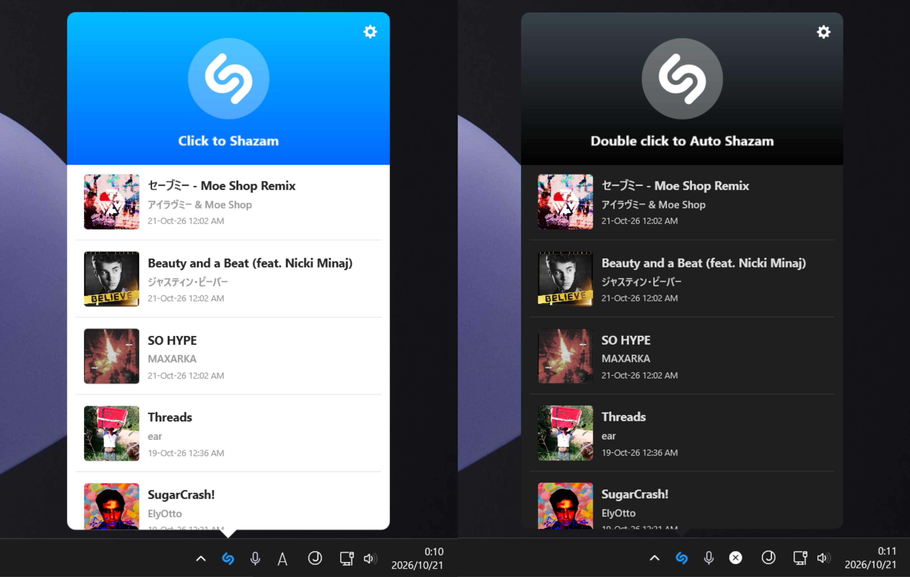

# OpenShazam

An unofficial Shazam client for Windows, built with Rust and a native tray UI. Recognize music playing on your PC, browse your history, or use Auto Shazam for continuous recognition.

## Build

On Windows, create `dist/windows-x64` and run `tools/build-windows.ps1 -Product`. This requires Rust 1.85, Visual Studio with C++ tools, the Windows SDK, and NuGet. To build the installer, use Inno Setup 6 with `installer/OpenShazam.iss`.
